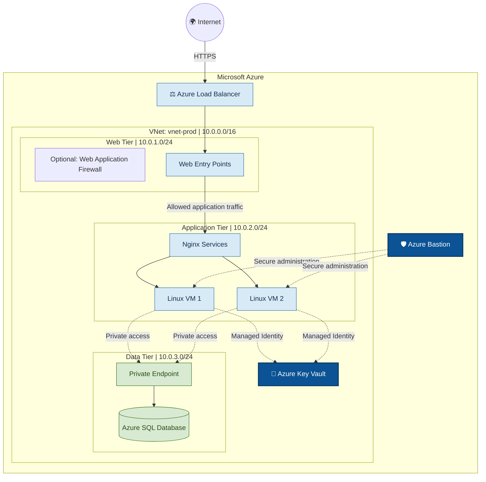

# ☁️ Azure Secure 3-Tier Platform
### Secure Cloud Infrastructure • Terraform • Ansible • Zero Trust

<p align="center">
  
  
  
  
  
</p>

<p align="center">
  <strong>Design, provision and secure a multi-tier cloud infrastructure on Microsoft Azure using Infrastructure as Code and configuration automation.</strong>
</p>

---

## 📌 Overview

**Azure Secure 3-Tier Platform** is a Cloud & DevOps project focused on designing a secure, maintainable and automated infrastructure on Microsoft Azure.

The project combines **Terraform** for infrastructure provisioning and **Ansible** for server configuration to demonstrate a reproducible deployment workflow based on Infrastructure as Code (IaC).

The architecture is designed around network segmentation, controlled administrative access, private communication between tiers and centralized secret management.

### 🎯 Project objectives

- Automate Azure infrastructure provisioning with Terraform.
- Separate Web, Application and Data workloads into dedicated network segments.
- Restrict direct public access to backend resources.
- Provide secure administrative access through Azure Bastion.
- Configure Linux servers automatically using Ansible.
- Apply least-privilege access principles and managed identities.
- Improve infrastructure consistency, security and maintainability.

---

## 🏗️ Architecture

The target architecture uses a dedicated Azure Virtual Network with three logical tiers and controlled communication paths.



### 🔍 Architecture components

| Component | Purpose |
|---|---|
| Azure Virtual Network | Isolated private network for cloud workloads |
| Web Tier | Entry point for incoming application traffic |
| Application Tier | Hosts Linux servers and application services |
| Data Tier | Isolates database access from public traffic |
| Azure Bastion | Secure administrative access to private VMs |
| Azure Load Balancer | Distributes traffic across configured backend instances |
| Azure Key Vault | Centralizes secrets, keys and certificates |
| Managed Identity | Allows supported Azure resources to authenticate without storing credentials |
| Private Endpoint | Provides private network access to supported Azure services |
| Terraform | Provisions and manages infrastructure declaratively |
| Ansible | Configures Linux servers and applies repeatable configuration tasks |

> **Security note:** The diagram represents the target design. Components such as the Web Application Firewall, Load Balancer, Azure SQL Private Endpoint and managed identities should be marked as implemented only after they have been deployed and validated.

---

## 🔐 Security Strategy

The project follows security principles commonly used in production cloud environments.

### Network security
- Separate workloads using dedicated subnets.
- Restrict inbound and outbound traffic using Network Security Groups (NSGs).
- Avoid exposing application and database servers directly to the public Internet.
- Prefer private connectivity for communication between tiers.
- Allow only the ports and protocols required by the application.

### Identity and access management
- Apply least-privilege permissions.
- Use Managed Identities where supported.
- Store application secrets in Azure Key Vault.
- Avoid hardcoding credentials in Terraform files, Ansible playbooks or Git repositories.

### Administrative access
- Use Azure Bastion for browser-based or native-client access to supported private virtual machines.
- Restrict SSH access and avoid public IP addresses on backend VMs.
- Protect SSH private keys and other authentication credentials.

### Infrastructure security
- Keep Terraform state files out of Git.
- Review changes with `terraform plan` before applying them.
- Use version control for infrastructure code.
- Validate server configuration through repeatable Ansible playbooks.

---

## ⚙️ Technology Stack

| Technology | Role |
|---|---|
| Microsoft Azure | Cloud infrastructure |
| Terraform | Infrastructure as Code |
| Ansible | Configuration management |
| Linux / Ubuntu | Server operating system |
| Nginx | Web server or reverse proxy, depending on deployment |
| Azure Bastion | Secure administrative access |
| Azure Key Vault | Secret management |
| Azure SQL | Managed relational database, if deployed |
| Git / GitHub | Version control and project documentation |

---

## 🚀 Deployment Workflow

```mermaid
flowchart LR
    A["📝 Terraform Code"] --> B["terraform init"]
    B --> C["terraform validate"]
    C --> D["terraform plan"]
    D --> E["terraform apply"]
    E --> F["☁️ Azure Resources"]
    F --> G["📋 Ansible Inventory"]
    G --> H["🔧 Ansible Playbook"]
    H --> I["🖥️ Configured Servers"]
    I --> J["✅ Connectivity & Security Tests"]

    classDef terraform fill:#E4D7F5,stroke:#7B42BC,color:#24113F;
    classDef azure fill:#D9EAF7,stroke:#0078D4,color:#12304A;
    classDef ansible fill:#FCE4D6,stroke:#CC4125,color:#5B1B0B;
    classDef test fill:#D9EAD3,stroke:#38761D,color:#274E13;

    class A,B,C,D,E terraform;
    class F azure;
    class G,H,I ansible;
    class J test;
```



### 1. Provision the infrastructure

```bash
terraform init
terraform fmt -recursive
terraform validate
terraform plan
terraform apply
```

Review the execution plan before applying infrastructure changes.

### 2. Configure the inventory

Create or generate an Ansible inventory containing the target private IP addresses and connection settings.

Example `ansible/inventory.ini`:

```ini
[webservers]
10.0.2.4
10.0.2.5

[webservers:vars]
ansible_user=azureuser
ansible_python_interpreter=/usr/bin/python3
```

Replace the example IP addresses and username with your actual values. Ensure the Ansible controller has a valid private network route and SSH access to the target machines.

### 3. Run the Ansible playbook

```bash
ansible-inventory -i ansible/inventory.ini --graph
ansible -i ansible/inventory.ini webservers -m ping
ansible-playbook -i ansible/inventory.ini ansible/playbook.yml
```

### 4. Validate the deployment

- Verify the status of Azure resources.
- Confirm connectivity between permitted network segments.
- Check Nginx service status and application responses.
- Verify NSG rules and private endpoint connectivity.
- Confirm that administrative access works without exposing backend VMs publicly.

---

## 📂 Repository Structure

```text
.
├── ansible/
│   ├── inventory.ini
│   ├── inventory.azure_rm.yaml
│   └── playbook.yml
├── app.tf
├── data.tf
├── main.tf
├── monitoring.tf
├── network.tf
├── providers.tf
├── random.tf
├── variable.tf
├── web.tf
├── .gitignore
├── .terraform.lock.hcl
└── README.md
```

*The directory tree may vary according to the modules and resources implemented in the final version.*

---

## 🧪 Validation Checklist

- [ ] Terraform configuration validated successfully.
- [ ] Infrastructure provisioned successfully.
- [ ] Web, Application and Data network segments configured.
- [ ] NSG rules restrict unauthorized traffic.
- [ ] Backend VMs have no public IP addresses.
- [ ] Azure Bastion administrative access tested.
- [ ] Ansible inventory correctly identifies the target hosts.
- [ ] Ansible playbook executes successfully and can be rerun.
- [ ] Private database connectivity verified, if Azure SQL is deployed.
- [ ] Managed Identity and Key Vault permissions verified, if configured.
- [ ] Terraform state and sensitive variables excluded from Git.

---

## 🛡️ Terraform State & Sensitive Data

Terraform state can contain sensitive infrastructure information. It must not be committed to Git.

Recommended `.gitignore` rules:

```gitignore
.terraform/
*.tfstate
*.tfstate.*
*.tfvars
*.tfvars.json
crash.log
crash.*.log
override.tf
override.tf.json
*_override.tf
*_override.tf.json
```

Keep `.terraform.lock.hcl` under version control to help maintain consistent provider selections.

For collaborative or production deployments, consider an appropriately secured remote Terraform backend with access controls, encryption and state locking where supported.

---

## 📈 Skills Demonstrated

- Cloud infrastructure design on Microsoft Azure
- Terraform workflows and Infrastructure as Code
- Linux server administration
- Network segmentation and access control
- Ansible automation and repeatable configuration
- Secure access and identity management
- Infrastructure validation and troubleshooting
- Git version control and technical documentation

---

## 👨‍💻 Author

**Jihed Dridi**  
Aspiring Cloud & DevOps Engineer

- Portfolio: https://jiheddridi.github.io/
- GitHub: https://github.com/Jiheddridi

---

<p align="center">
  <strong>Building secure, automated and reproducible cloud infrastructure.</strong>
</p>
