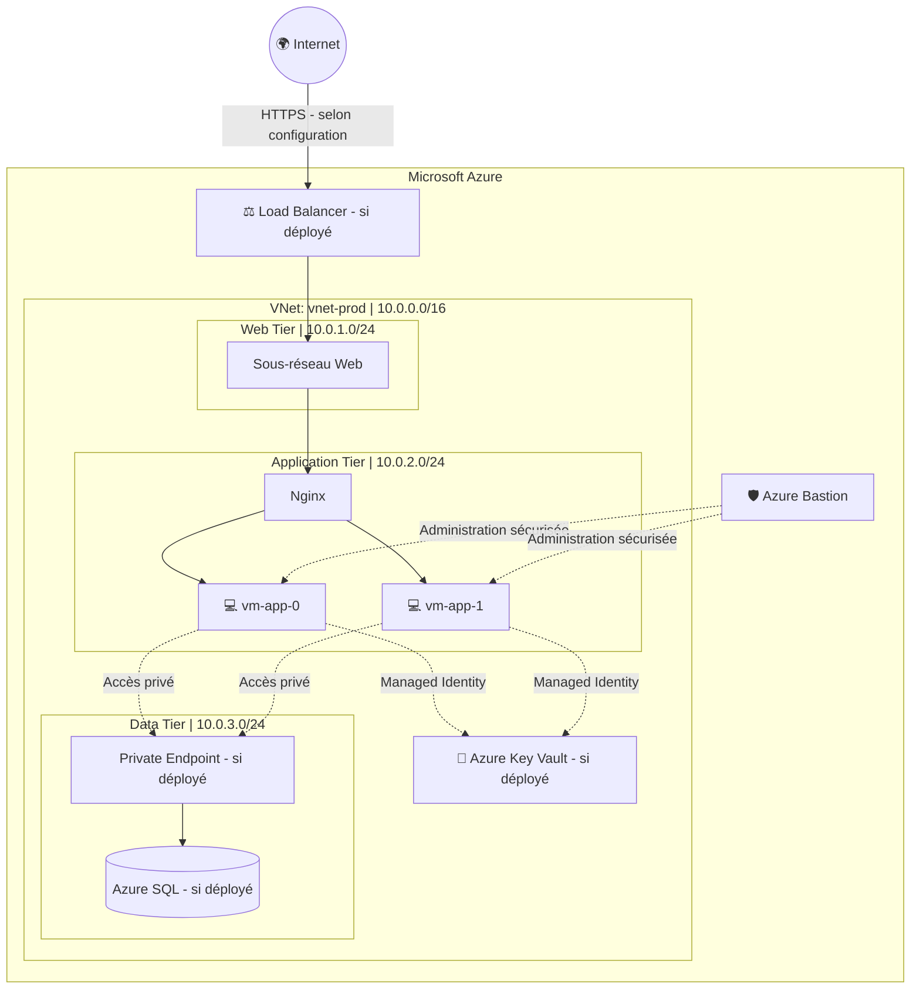

# 🛡️ Azure Secure 3-Tier Platform

<p align="center">
  <strong>Infrastructure as Code with Terraform & Configuration Management with Ansible</strong>
</p>

<p align="center">
  <a href="https://azure.microsoft.com/">
    
  </a>
  <a href="https://www.terraform.io/">
    
  </a>
  <a href="https://www.ansible.com/">
    
  </a>
  
</p>

---

## 🚀 Aperçu du projet

Ce projet consiste à concevoir et automatiser une infrastructure cloud sécurisée sur **Microsoft Azure**, en combinant Terraform pour le provisionnement des ressources et Ansible pour la configuration des serveurs Linux.

L'objectif est de mettre en œuvre une architecture segmentée, de contrôler les accès administratifs et de rendre le déploiement reproductible grâce à l'Infrastructure as Code (IaC) et à l'automatisation.

### 🎯 Objectifs

- Automatiser la création des ressources Azure avec Terraform.
- Segmenter le réseau en sous-réseaux dédiés.
- Limiter l'exposition publique des machines virtuelles.
- Sécuriser l'administration avec Azure Bastion.
- Configurer automatiquement les serveurs avec Ansible.
- Centraliser les secrets dans Azure Key Vault.
- Appliquer les principes du moindre privilège et du Zero Trust.

### 🔐 Principes de sécurité

- **Accès réseau contrôlé :** règles NSG restrictives et segmentation du réseau.
- **Administration sécurisée :** accès aux VM privées via Azure Bastion.
- **Gestion des identités :** Managed Identities et RBAC lorsque configurés.
- **Protection des secrets :** Azure Key Vault, sans identifiants sensibles codés en dur.
- **Connectivité privée :** Private Endpoint pour les services compatibles, si déployé.
- **Automatisation fiable :** playbooks Ansible conçus pour être idempotents.

---

## 🏗️ Architecture Azure

<p align="center">
  
</p>

<p align="center">
  <em>Vue du portail Azure — remplace cette image par une capture réelle de ton infrastructure.</em>
</p>



### 📌 Composants principaux

| Composant | Rôle |
|---|---|
| Azure Virtual Network | Réseau privé isolé |
| Subnets | Segmentation des couches Web, Application et Data |
| Linux Virtual Machines | Hébergement des services |
| Nginx | Serveur Web ou reverse proxy |
| Azure Bastion | Accès administratif aux VM privées |
| Network Security Groups | Filtrage du trafic réseau |
| Terraform | Provisionnement déclaratif des ressources |
| Ansible | Configuration automatisée des serveurs |
| Azure Key Vault | Stockage sécurisé des secrets, si configuré |
| Azure SQL / Private Endpoint | Base de données et connectivité privée, si configurées |

> **Important :** le schéma présente l'architecture cible. Les composants optionnels doivent être conservés dans le diagramme uniquement s'ils existent réellement dans le déploiement.

---

## 🔄 Workflow DevOps


### Étapes du workflow

1. **Terraform :** initialiser les providers et le backend.
2. **Validation :** contrôler la syntaxe et examiner le plan.
3. **Provisionnement :** créer ou mettre à jour les ressources Azure.
4. **Connectivité :** préparer l'accès SSH aux VM privées.
5. **Ansible :** installer et configurer Nginx.
6. **Validation :** tester la connectivité, les services et l'idempotence.

---

## 🛠️ Stack technique

| Domaine | Technologie | Utilisation |
|---|---|---|
| Cloud | Microsoft Azure | Hébergement de l'infrastructure |
| IaC | Terraform / AzureRM | Gestion déclarative des ressources |
| Configuration | Ansible | Configuration des serveurs Linux |
| Système | Ubuntu / Linux | Environnement serveur |
| Web | Nginx | Service Web et reverse proxy |
| Réseau | VNet, Subnets, NSG | Isolation et filtrage |
| Accès sécurisé | Azure Bastion | Administration des VM privées |
| Identité | Microsoft Entra ID, RBAC | Gestion des accès |
| Secrets | Azure Key Vault | Gestion centralisée des secrets |
| Versionnement | Git / GitHub | Historique et documentation |

---

## 📂 Structure du projet

```text
terraformassociate/
├── ansible/
│   ├── inventory.ini
│   ├── inventory.azure_rm.yaml
│   └── playbook.yml
├── app.tf
├── data.tf
├── main.tf
├── monitoring.tf
├── network.tf
├── providers.tf
├── random.tf
├── variable.tf
├── web.tf
├── .gitignore
├── .terraform.lock.hcl
└── README.md
```

*Adapte cette arborescence à la structure réelle de ton dépôt.*

---

## ⚡ Guide de déploiement

### 1. Prérequis

- Un compte Microsoft Azure avec les permissions nécessaires.
- Terraform installé.
- Azure CLI installé et authentifié.
- Ansible installé sur la machine de contrôle.
- Une connectivité SSH fonctionnelle vers les VM cibles.

Connexion à Azure :

```bash
az login
az account show
```

### 2. Initialiser et déployer Terraform

Depuis le répertoire contenant les fichiers `.tf` :

```bash
terraform init
terraform fmt -recursive
terraform validate
terraform plan
terraform apply
```

Examine le plan avant de confirmer l'application des changements.

### 3. Vérifier les ressources Azure

```bash
az group show \
  --name lergprod \
  --output table

az vm list \
  --resource-group lergprod \
  --show-details \
  --output table
```

### 4. Préparer l'accès aux VM privées

Pour utiliser un tunnel Azure Bastion, le Bastion doit prendre en charge la fonctionnalité de tunneling et être configuré correctement.

Exemple pour la première VM :

```bash
az network bastion tunnel \
  --name bastion-prod \
  --resource-group lergprod \
  --target-resource-id "<ID_VM_APP_0>" \
  --resource-port 22 \
  --port 2222
```

Remplace `<ID_VM_APP_0>` par l'identifiant réel de la VM. Garde le processus du tunnel actif pendant l'utilisation de la connexion.

### 5. Configurer Ansible

Exemple d'inventaire pour un tunnel SSH local :

```ini
[app]
vm-app-0 ansible_host=127.0.0.1 ansible_port=2222 ansible_user=azureuser

[app:vars]
ansible_connection=ssh
ansible_python_interpreter=/usr/bin/python3
```

Adapte l'utilisateur et la clé SSH à ta configuration. Si plusieurs tunnels sont utilisés simultanément, chacun doit avoir son propre port local.

Tester la connexion :

```bash
ansible -i ansible/inventory.ini app -m ping
```

Exécuter le playbook :

```bash
ansible-playbook \
  -i ansible/inventory.ini \
  ansible/playbook.yml
```

Relancer le playbook permet de vérifier l'idempotence : une configuration déjà conforme ne doit pas produire de modifications inutiles.

---

## 🧪 Checklist de validation

- [ ] `terraform validate` s'exécute sans erreur.
- [ ] Les ressources attendues sont présentes sur Azure.
- [ ] Les sous-réseaux et les règles NSG sont correctement configurés.
- [ ] Les VM privées ne possèdent pas d'IP publique.
- [ ] L'accès administratif est opérationnel.
- [ ] Ansible atteint les machines cibles.
- [ ] Nginx est installé et fonctionne.
- [ ] Les communications réseau non autorisées sont bloquées.
- [ ] Les services privés optionnels ont été testés.
- [ ] Une seconde exécution Ansible ne provoque pas de changements inutiles.

---

## 🔒 Bonnes pratiques de sécurité

### Fichier `.gitignore`

```gitignore
# Terraform
.terraform/
*.tfstate
*.tfstate.*
crash.log
crash.*.log
override.tf
override.tf.json
*_override.tf
*_override.tf.json

# Variables et secrets
*.tfvars
*.tfvars.json
.env
.env.*

# Clés privées
*.pem
*.key
id_rsa
id_ed25519
```

Le fichier `.terraform.lock.hcl` doit normalement être versionné. Les fichiers d'état Terraform peuvent contenir des données sensibles et ne doivent pas être publiés.

Pour un projet collaboratif, privilégie un backend distant sécurisé, avec les contrôles d'accès et les mécanismes de verrouillage disponibles.

---

## 📈 Compétences démontrées

- Infrastructure as Code avec Terraform
- Provisionnement cloud sur Microsoft Azure
- Administration Linux
- Segmentation réseau et filtrage du trafic
- Automatisation de configuration avec Ansible
- Gestion des identités et des accès
- Accès sécurisé aux machines virtuelles
- Validation et dépannage d'infrastructure
- Versionnement Git et documentation technique

---

## 👨‍💻 Auteur

**Jihed Dridi**  
Aspiring Cloud & DevOps Engineer

- 🌐 Portfolio : [jiheddridi.github.io](https://jiheddridi.github.io/)
- 💻 GitHub : [Jiheddridi](https://github.com/Jiheddridi)

---

<p align="center">
  <strong>Secure by design. Automated by code. Built for the cloud. ☁️</strong>
</p>
